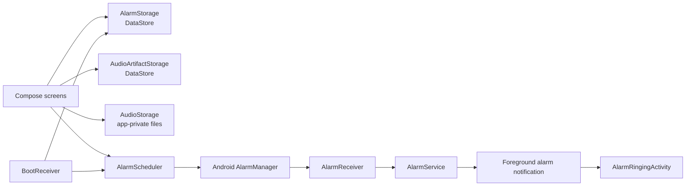

# AlarMosaic

AlarMosaic is a native Android alarm-clock application built with Kotlin and Jetpack Compose. It lets a user create one-time or weekly repeating alarms, attach locally imported audio, and manage a small on-device media library.

## Status

This is an in-development, single-module Android application. The repository contains the application source and Gradle wrapper, but no release artifacts, automated test sources, screenshots, deployment configuration, or license file. This README is based on static inspection; a build or device run was not performed as part of this documentation update.

## Implemented features

- Create alarms with a time, optional label, and optional repeat days.
- Schedule enabled alarms with `AlarmManager.setExactAndAllowWhileIdle` and re-schedule repeating alarms after they fire.
- Enable, disable, and delete alarms from the main list.
- Import audio through Android's document picker; files are copied into the app's private storage.
- Name imported audio, preview it, select it for an alarm, and manage it from the Media Library.
- Prevent deletion of a library sound that is referenced by an alarm.
- Start a foreground media-playback service when an alarm fires, show a high-priority/full-screen alarm notification, and provide a stop action.
- Display an alarm screen over the lock screen and turn the screen on where the platform permits it.
- Restore enabled alarms after device boot when exact-alarm access is available.

## Important behavior and current limitations

- Exact alarm scheduling depends on Android system access. When unavailable, the app sends the user to Android's exact-alarm settings before saving a new alarm.
- The UI offers a "Default sound" state, but the service only starts playback when an alarm has a custom audio path. The default ringtone implementation is commented out, so an alarm without custom audio has no active sound-playback code path.
- The **Choose Background** control previews a selected image while creating an alarm, but that image is not stored in the `Alarm` model or used by the ringing screen.
- There is no alarm-edit or snooze UI in the current source.
- Alarm and media metadata are serialized into delimited strings in DataStore without escaping. Labels or media names containing delimiters such as commas or pipes can make saved data unparsable.
- Imported audio is copied with an `.mp3` filename regardless of the source format; the code does not validate or transcode it.

## Technology stack

| Area | Implementation |
| --- | --- |
| Language | Kotlin 2.3.20 |
| UI | Jetpack Compose with Material 3 |
| Build | Gradle 9.1.0, Android Gradle Plugin 9.0.1 |
| Android SDK | `minSdk` 24, `compileSdk`/`targetSdk` 36 |
| Persistence | AndroidX DataStore Preferences and files in app-private storage |
| Alarm delivery | `AlarmManager`, broadcast receivers, and a foreground `Service` |
| Media | Android `MediaPlayer`; Coil Compose for the add-alarm image preview |

## Architecture

The app keeps UI state in Compose screens and persists alarms, media metadata, and IDs locally. `AlarmScheduler` translates an enabled `Alarm` into an exact `AlarmManager` pending intent. When it fires, `AlarmReceiver` starts `AlarmService`; the service creates the foreground notification and opens `AlarmRingingActivity` through its full-screen intent. `BootReceiver` reloads and schedules enabled alarms after boot.



## Project structure

```text
.
|-- app/
|   |-- build.gradle.kts                 # Android app module and dependencies
|   `-- src/main/
|       |-- AndroidManifest.xml          # Components and required permissions
|       `-- java/com/example/alarmosaic/
|           |-- MainActivity.kt          # Compose entry point and notification permission request
|           |-- AlarmScreen.kt           # Alarm list, scheduling, toggling, and deletion
|           |-- AddAlarmScreen.kt        # Alarm form, repeat selection, and media selection
|           |-- MediaLibraryScreen.kt    # Imported-audio management
|           |-- AlarmScheduler.kt        # Exact scheduling and pending intents
|           |-- AlarmReceiver.kt         # Fired-alarm receiver
|           |-- AlarmService.kt          # Foreground playback service and notification
|           |-- AlarmRingingActivity.kt  # Full-screen ringing UI
|           |-- BootReceiver.kt          # Boot-time alarm restoration
|           `-- *Storage.kt              # DataStore and audio-file persistence
|-- gradle/
|   |-- libs.versions.toml               # Version catalog
|   `-- wrapper/                          # Gradle wrapper configuration
|-- build.gradle.kts                      # Root build configuration
|-- settings.gradle.kts                   # Project/module settings
|-- gradlew / gradlew.bat                 # Gradle wrappers
`-- README.md
```

## Prerequisites

- Android Studio, or an Android-compatible JDK/SDK and the Gradle wrapper environment.
- Android SDK Platform 36 to compile the project.
- An Android device or emulator running API 24 or later.

For reliable alarm behavior, test on a device where Android permits exact alarms, notifications, foreground media playback, and full-screen alarm intents. Platform and device policy can affect these capabilities.

## Build and install

Clone the repository and build the debug APK with the included Gradle wrapper.

**Windows (PowerShell)**

```powershell
.\gradlew.bat assembleDebug
```

**macOS/Linux**

```bash
./gradlew assembleDebug
```

The debug APK is produced at `app/build/outputs/apk/debug/app-debug.apk`. To build and install it on a connected device or running emulator:

```powershell
.\gradlew.bat installDebug
```

Alternatively, open the repository in Android Studio, allow Gradle sync to complete, select a device, and run the `app` configuration.

No environment variables, backend services, API keys, or database migrations are defined by this repository.

## Permissions and setup on the device

The manifest requests these Android permissions and capabilities:

- `SCHEDULE_EXACT_ALARM` for precise alarm delivery.
- `POST_NOTIFICATIONS`, requested at runtime on Android 13 and later.
- `FOREGROUND_SERVICE` and `FOREGROUND_SERVICE_MEDIA_PLAYBACK` for alarm playback.
- `USE_FULL_SCREEN_INTENT` for the ringing experience.
- `RECEIVE_BOOT_COMPLETED` to restore alarms after reboot.

If exact-alarm access has not been granted, use the app's prompt to open the system setting, enable the access, then return to the app. Android may also require notification permission before the alarm notification can be shown.

## Usage

1. Launch the app and grant notification permission when prompted on Android 13+.
2. Select **+ ADD ALARM**, choose a time, optionally enter a label, and select repeat days. Leaving all days unselected makes it a one-time alarm.
3. Optionally import an audio file or select one from **Media Library**. Imported files can be previewed and named before saving to the library.
4. Save the alarm. If exact-alarm access is unavailable, enable it in the Android settings screen and return to the app.
5. Use the switch to enable or disable an alarm. Delete cancels its scheduled pending intent and removes it from local storage.
6. When an alarm fires, stop it with the notification action or the full-screen alarm screen.

## Testing and troubleshooting

There are no tracked `src/test` or `src/androidTest` sources, so no automated test suite is currently documented. A build or test task was not executed for this README update.

If an alarm does not fire, check that:

- exact-alarm access is enabled for AlarMosaic in Android settings;
- the alarm is enabled and its scheduled time is still in the future;
- notifications and relevant foreground-service/full-screen-intent capabilities have not been restricted by the device; and
- a custom audio file still exists when the alarm is expected to play sound.

## Privacy and data storage

The implementation contains no network client, remote backend, analytics integration, or environment-based configuration. Alarm records and media metadata are stored with DataStore Preferences; imported audio is copied to the app's internal files directory. Removing the app normally removes this app-private data.

## Contributing

If you contribute, keep changes focused, format Kotlin consistently, and validate the affected behavior on an Android device or emulator. Add appropriate unit or instrumented tests alongside new logic where practical.

## License

No license file is present in the repository. Do not assume any license or reuse terms without confirmation from the project owner.
